# Heat Pump Controller + Remote — Dual ESP32 via ESP-NOW

ESP32-based smart heat pump controller split across **two boards** communicating wirelessly via **ESP-NOW** (~500µs latency, no router needed).

Full replacement for a heat pump control board with Home Assistant integration, a built-in web page, wireless firmware updates for both boards, and complete control logic.

The indoor Remote comes in two versions that share the same firmware core:

| | Button Remote (`env:remote`) | **Touch Remote** (`env:remote_s3`) |
|--|--|--|
| MCU | ESP32 (WROOM) | ESP32-S3 N16R2 (16 MB flash, 2 MB PSRAM) |
| Display | ST7567 128×64 | **ERC240160 240×160 FSTN** (ST7586S) |
| Input | 5 push buttons | **4-wire resistive touch** |
| UI | Text menu | Tiles, icons, animated screens |
| ESP-NOW, WiFi, MQTT/HA, web page, OTA | ✅ | ✅ (same code) |

<p align="center">
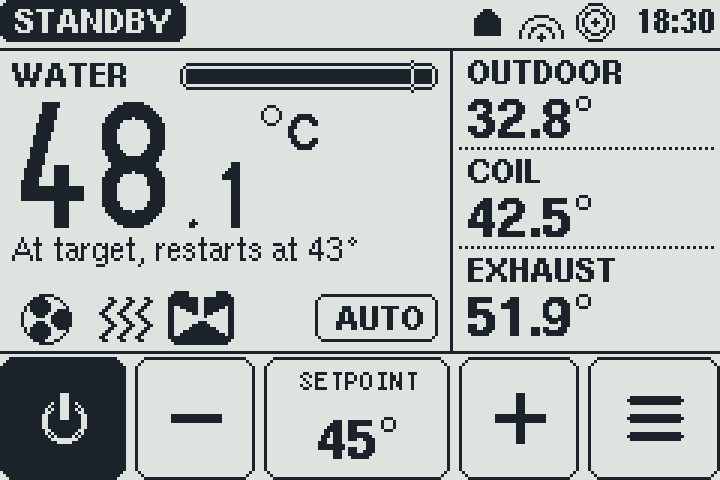<br>
<sub>Touch Remote main screen, captured from the panel's frame buffer.</sub>
</p>

---

> [!CAUTION]
> ## ⚡ ELECTRICAL SAFETY — 230V AC MAINS VOLTAGE
>
> This project involves direct connection to **230V AC mains electricity**.
> Improper handling can cause **electric shock, fire, or death**.
>
> - **Only qualified and licensed electricians** should install or service this system.
> - **Disconnect and lock out mains power** before opening the heat pump enclosure or touching any wiring.
> - The relay outputs switch **live 230V loads** — compressor (30A), fan, valve, and pump.
> - Do not operate with the enclosure open or with exposed conductors.
> - Verify local electrical codes and regulations before installation.
>
> **If you are not trained and certified to work with high-voltage systems — do not attempt this project.**

---

## Architecture Overview

```
┌─────────────────────────────┐         ESP-NOW (2.4GHz)        ┌─────────────────────────────┐
│        CONTROLLER           │◄────────────────────────────────►│           REMOTE            │
│      (Outdoor unit)         │                                  │        (Indoor unit)         │
│                             │  StatusPacket every 500ms ──►    │                             │
│  • 4× NTC temperature       │  ◄── CommandPacket (on action)   │  • LCD + buttons, or        │
│    sensors                  │  ◄── SettingsPacket (on change)  │    240×160 LCD + touch      │
│  • 4× relay outputs         │  ◄── OTA chunks (fw update)      │  • WiFi + MQTT              │
│  • Control state machine    │  InfoPacket (fw version) ──►     │  • Home Assistant           │
│  • No WiFi / no display     │                                  │  • Web page + OTA           │
└─────────────────────────────┘                                  └─────────────────────────────┘
```

### Key Design Principles

| | Controller | Remote |
|--|--|--|
| **Role** | Real hardware control | UI + cloud connectivity |
| **Works without the other?** | ✅ Yes — keeps running autonomously | ✅ Yes — shows last known state |
| **WiFi** | ✗ Not needed | ✅ Connects to router via WiFiManager |
| **Settings stored** | Receives from Remote, saves to NVS | Master copy in NVS, synced on every save |
| **MQTT / HA** | ✗ | ✅ Full Discovery |
| **Firmware update** | Over ESP-NOW, sent by the Remote | From its own web page |

---

## Photos

### Phase 1 — Firmware & UI Development

Early bench testing of the LCD menu system before any hardware was assembled.

<table>
<tr>
<td align="center" width="50%">
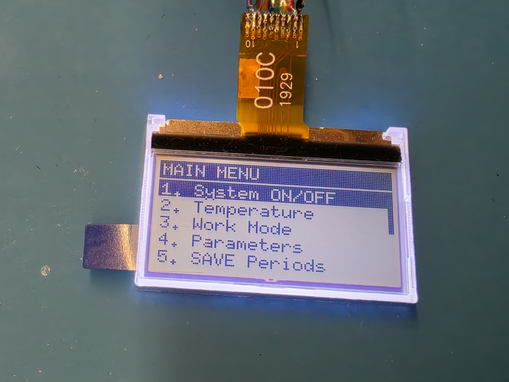<br>
<sub>Main Menu on the ST7567 LCD — System ON/OFF, Temperature, Work Mode, Parameters and SAVE Periods all working in the first firmware build.</sub>
</td>
<td align="center" width="50%">
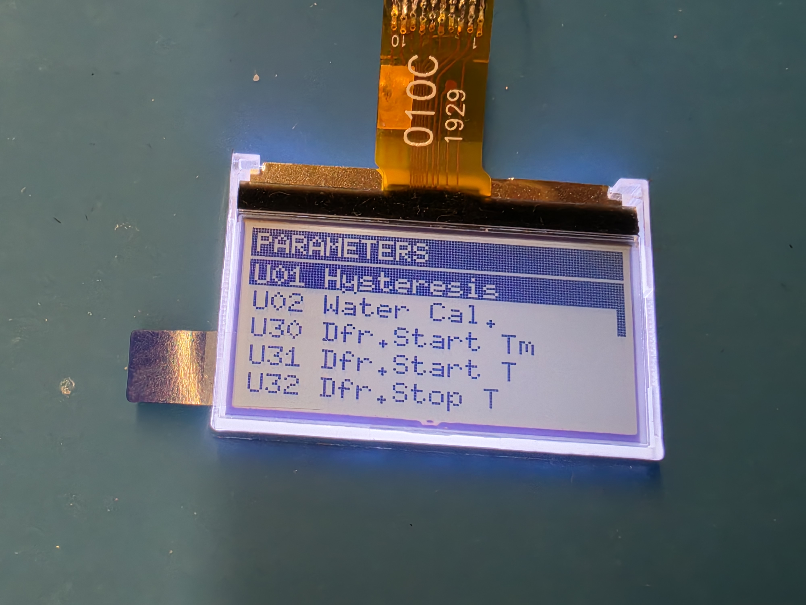<br>
<sub>Parameters screen showing the defrost and calibration settings (U01–U32) — the full configuration menu navigable directly from the display.</sub>
</td>
</tr>
</table>

---

### Phase 2 — First Prototype

First time both boards were connected together and communicating over ESP-NOW.

<table>
<tr>
<td align="center" width="50%">
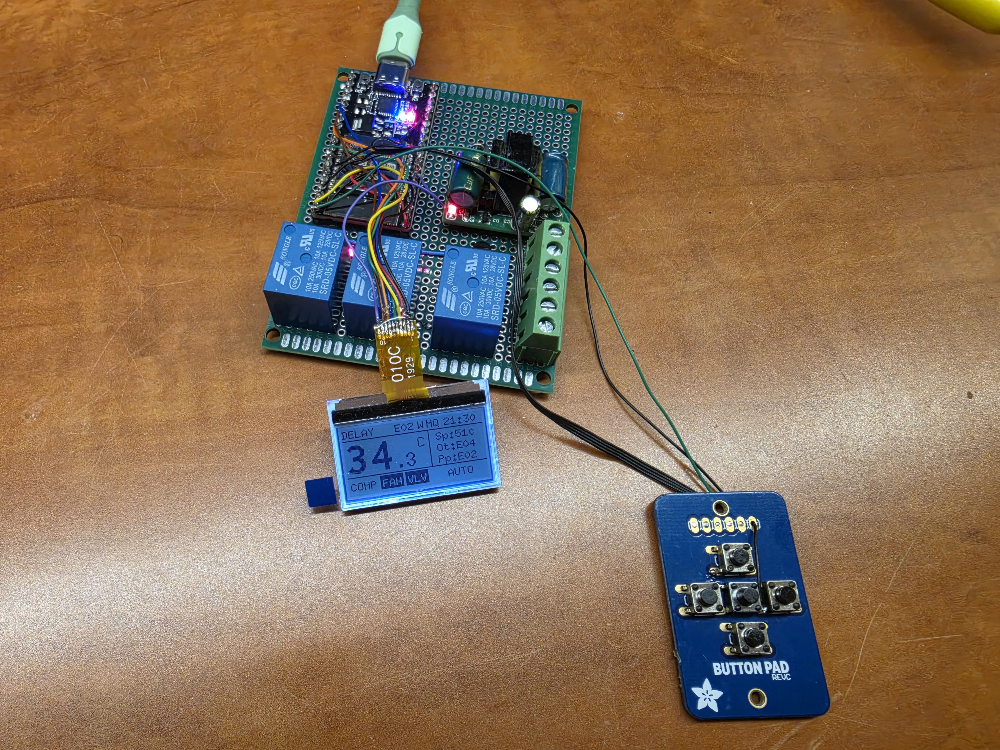<br>
<sub>First working prototype — the Controller perfboard (relays + ESP32) wired to the Remote's LCD and a 5-button pad. Both boards talking over ESP-NOW for the first time.</sub>
</td>
<td align="center" width="50%">
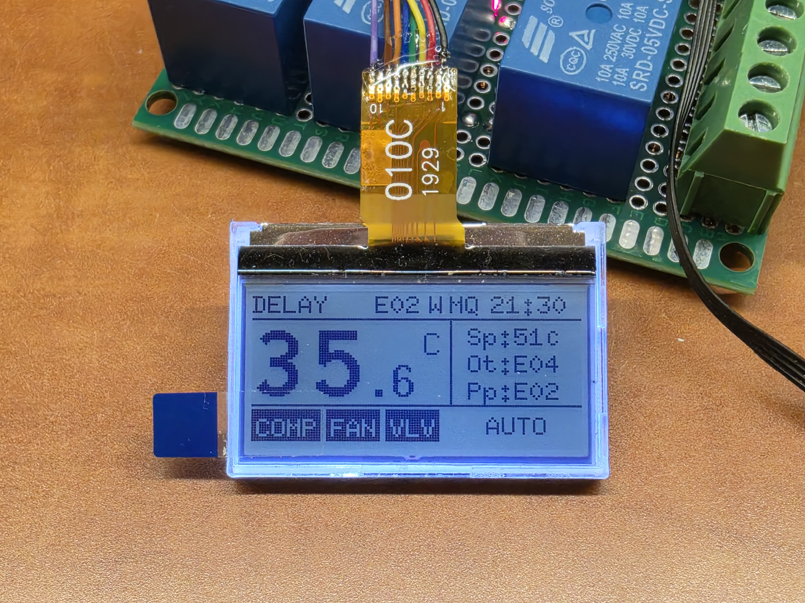<br>
<sub>LCD showing live status received from the Controller: water temp 35.6°C, setpoint 51°C, relay states (COMP / FAN / VLV) and operating mode — all transmitted wirelessly at 500 ms intervals.</sub>
</td>
</tr>
</table>

---

### Phase 3 — PCB Build & Assembly

Building the final perfboard PCBs for both units.

<table>
<tr>
<td align="center" width="50%">
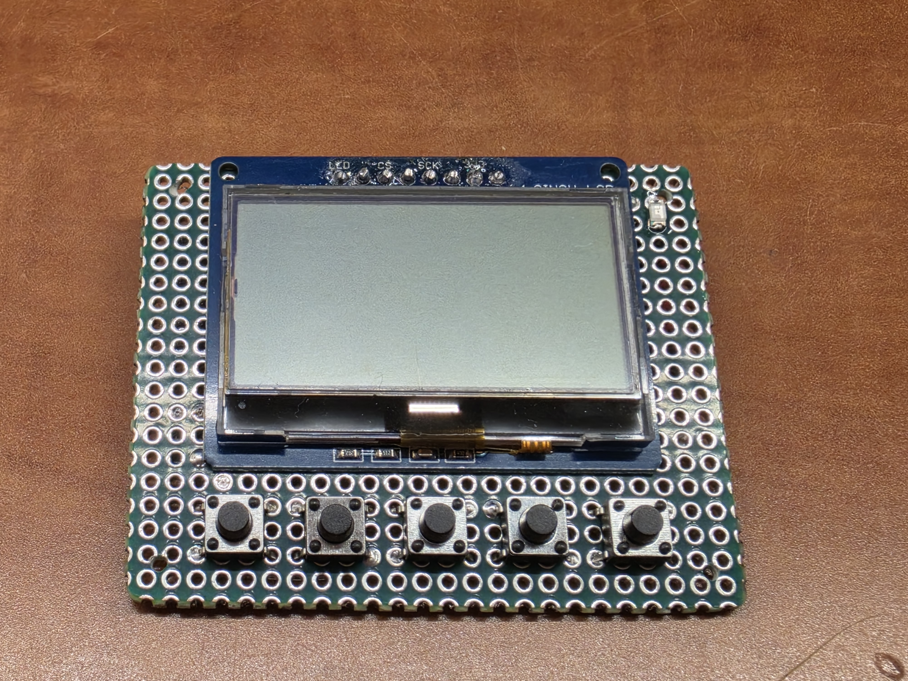<br>
<sub>Remote PCB — front view. The ST7567 LCD module sits centrally with the 5 navigation buttons mounted below it on the perfboard.</sub>
</td>
<td align="center" width="50%">
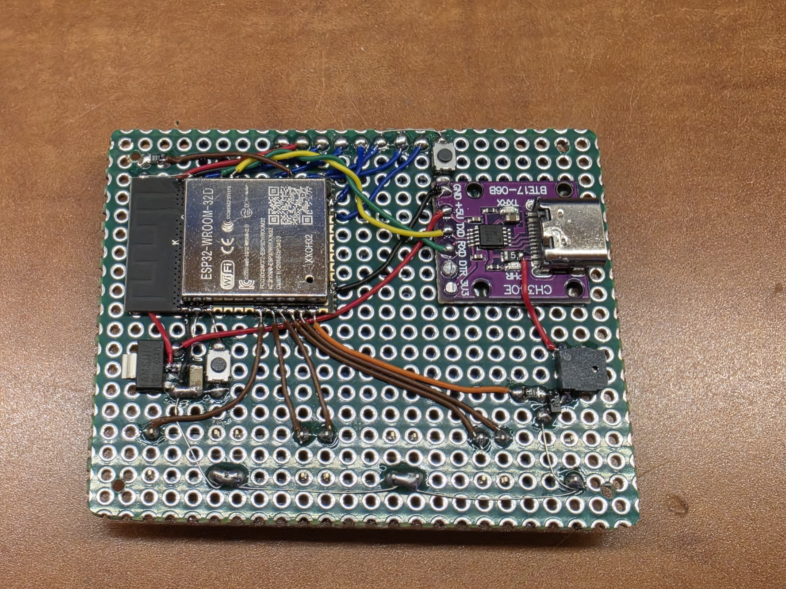<br>
<sub>Remote PCB — back view. The ESP32-WROOM module and a USB-C power board are soldered in, with hand-wired connections to the LCD and buttons.</sub>
</td>
</tr>
<tr>
<td align="center" width="50%">
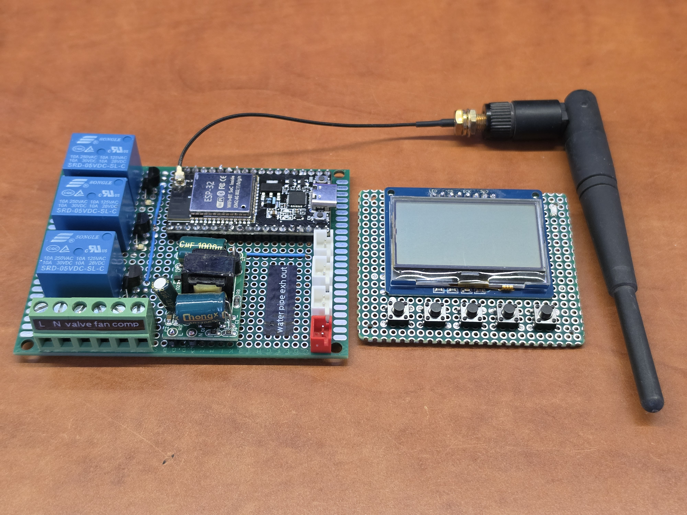<br>
<sub>Both finished boards side by side before installation — Controller (left, with 4 relays and WiFi antenna) and Remote (right, with LCD, buttons and antenna).</sub>
</td>
<td align="center" width="50%">
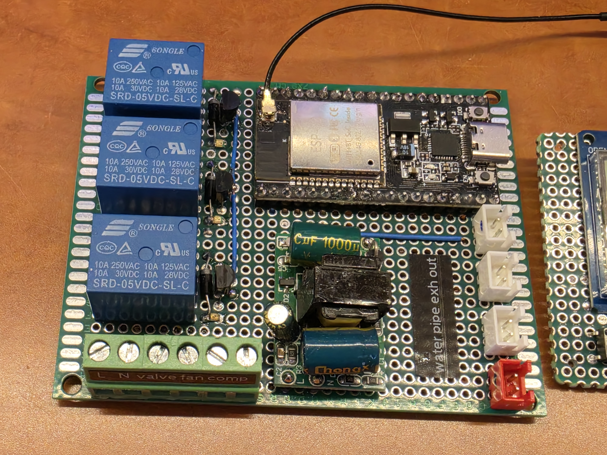<br>
<sub>Controller PCB close-up — three SONGLE 250V/10A relays, the ESP32 module, and the NTC sensor terminal blocks labeled water / pipe / exhaust / outdoor.</sub>
</td>
</tr>
<tr>
<td align="center" width="50%">
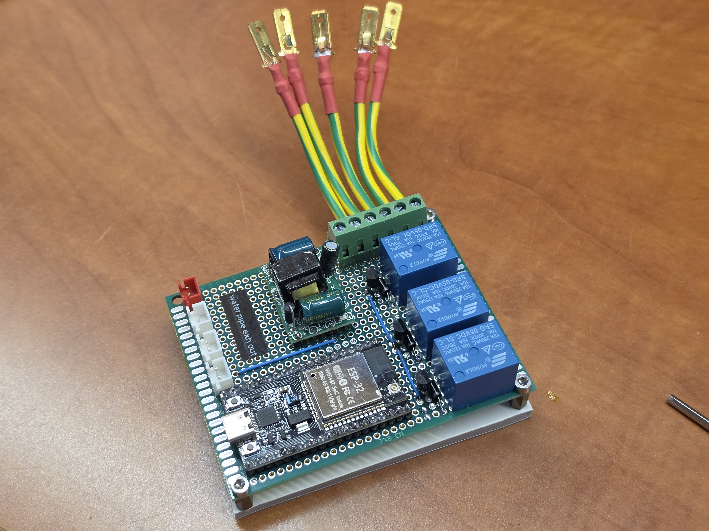<br>
<sub>Controller board with the 230V relay output wiring attached — yellow/green and red cables terminated with spade connectors, ready to connect to the heat pump loads.</sub>
</td>
<td align="center" width="50%">
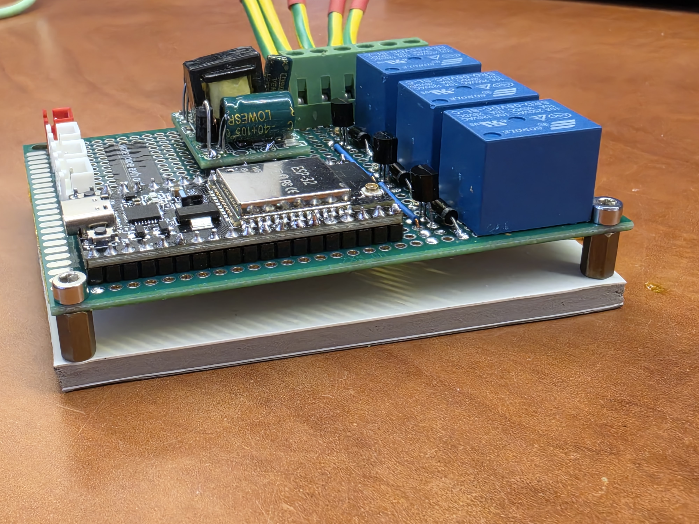<br>
<sub>Controller board mounted on standoffs above an aluminium enclosure base — provides physical protection and electrical isolation from the heat pump chassis.</sub>
</td>
</tr>
</table>

---

### Phase 4 — Installation in the Heat Pump

Installing the Controller into the outdoor unit and connecting all sensors and loads.

<table>
<tr>
<td align="center" width="50%">
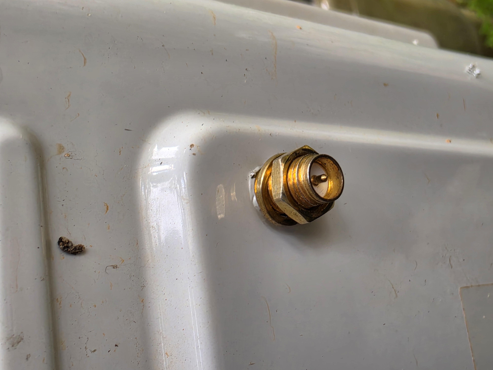<br>
<sub>SMA connector mounted on the heat pump enclosure for the external antenna — required for reliable ESP-NOW range since the Controller board sits inside a metal housing.</sub>
</td>
<td align="center" width="50%">
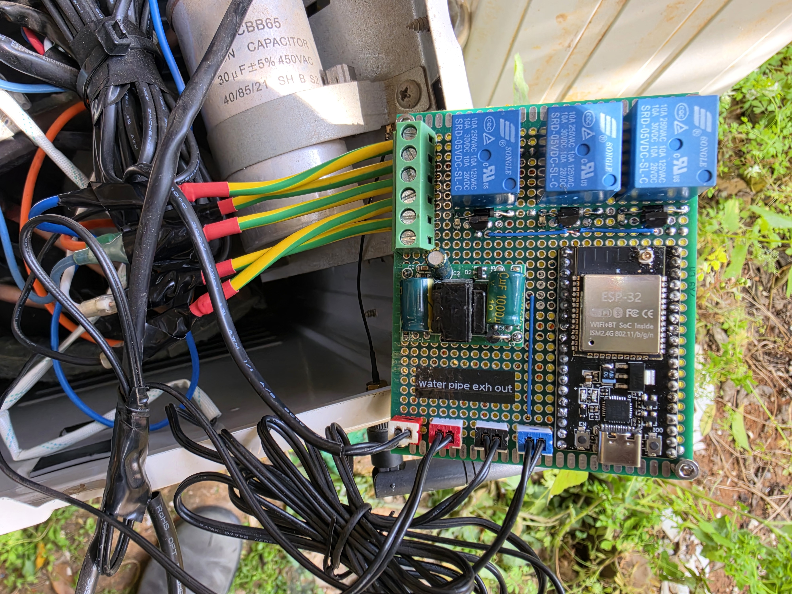<br>
<sub>Controller board installed inside the heat pump outdoor enclosure with all relay and sensor wiring connected. The ESP32 communicates wirelessly to the indoor Remote — no data cable needed.</sub>
</td>
</tr>
</table>

---

### Phase 5 — Home Assistant Integration

The Remote connects to Home Assistant via MQTT with full auto-discovery — no manual entity configuration needed.

<table>
<tr>
<td align="center" width="33%">
<br>
<sub>Home Assistant climate card — heat pump in Idle mode, setpoint 47°C, current water temp 29.8°C.</sub>
</td>
<td align="center" width="33%">
<br>
<sub>HA device page — all auto-discovered entities: climate control, compressor state, defrost status, and all four temperature sensors.</sub>
</td>
<td align="center" width="33%">
<br>
<sub>Heat pump actively Heating — setpoint 48°C, current water temp 32.3°C. Controlled directly from the HA app.</sub>
</td>
</tr>
</table>

---

### Phase 6 — Final Installed Product

The Remote unit installed indoors, fully operational.

<table>
<tr>
<td align="center" width="33%">
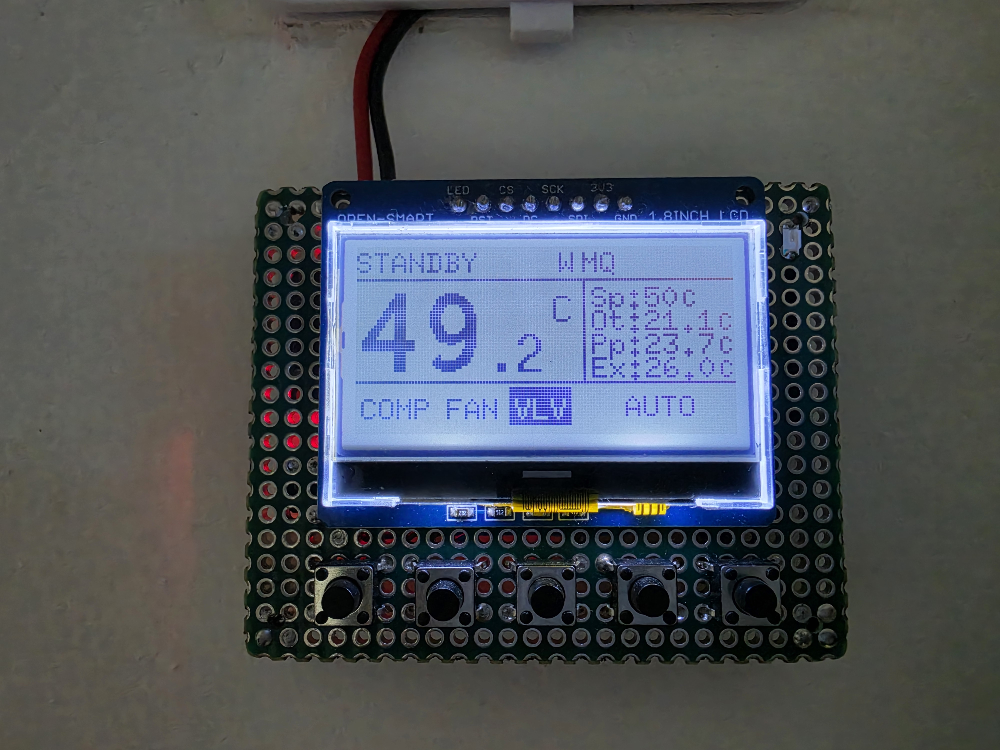<br>
<sub>Remote on the wall — main status screen: STANDBY, water 49.2°C, setpoint 50°C, outdoor 21.1°C, pipe 23.7°C, exhaust 26.0°C. 4-way valve active indicator visible.</sub>
</td>
<td align="center" width="33%">
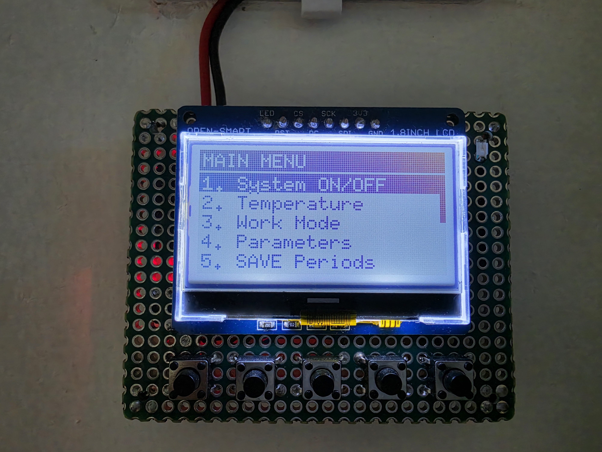<br>
<sub>Main Menu — System ON/OFF, Temperature, Work Mode, Parameters, and SAVE Periods — all accessible directly from the wall-mounted Remote.</sub>
</td>
<td align="center" width="33%">
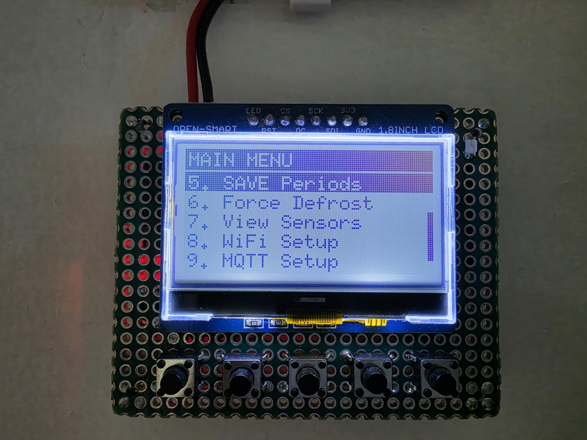<br>
<sub>Extended menu — Force Defrost, View Sensors, WiFi Setup, and MQTT Setup. Full configuration without a computer or phone.</sub>
</td>
</tr>
</table>

---

### Phase 7 — Touch Remote (ESP32-S3)

A second-generation Remote with a 3.4" 240×160 FSTN panel and a resistive touch screen. All screenshots below were captured over USB from the panel's frame buffer while it ran against the real Controller (see [Screenshots](#screenshots-from-the-device)).

<table>
<tr>
<td align="center" width="50%">
<br>
<sub><b>Main screen.</b> State chip, clock, MQTT / WiFi / link icons. Water temperature with a bar toward the setpoint (the notch is the restart point, SP − U01) and a plain-language state line. Outdoor, coil and exhaust on the right. Inverted tiles = running loads (fan spins, compressor heat waves move). Bottom: power, setpoint −/+, menu.</sub>
</td>
<td align="center" width="50%">
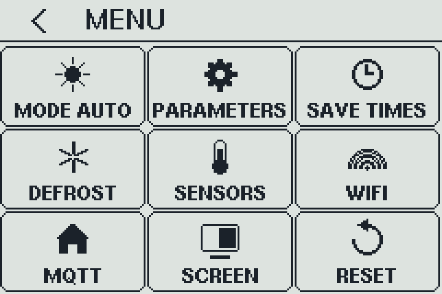<br>
<sub><b>Menu.</b> Nine tiles: work mode (tap toggles AUTO/SAVE), parameters, SAVE times, forced defrost, sensors, WiFi, MQTT, screen settings and factory reset.</sub>
</td>
</tr>
<tr>
<td align="center" width="50%">
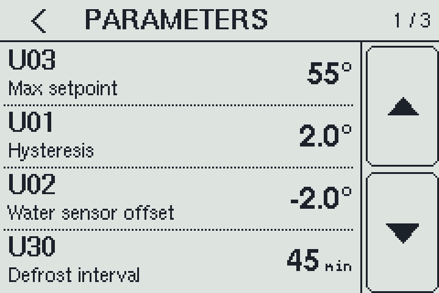<br>
<sub><b>Parameters.</b> All 12 U-parameters on three pages with their live values. Tap a row to edit.</sub>
</td>
<td align="center" width="50%">
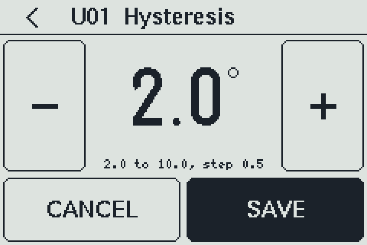<br>
<sub><b>Editor.</b> Large −/+ keys with auto-repeat (faster after 2 s). The new value rolls in from the direction of the change. Range and step are shown under the value.</sub>
</td>
</tr>
<tr>
<td align="center" width="50%">
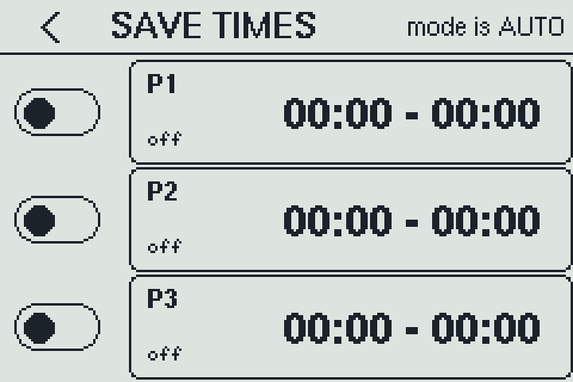<br>
<sub><b>SAVE times.</b> Three periods with animated on/off switches. Tap a period to edit its times.</sub>
</td>
<td align="center" width="50%">
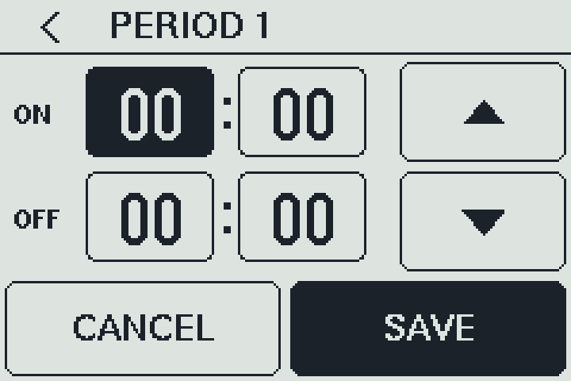<br>
<sub><b>Period editor.</b> Tap a field (hours / minutes), then step it with the arrows.</sub>
</td>
</tr>
<tr>
<td align="center" width="50%">
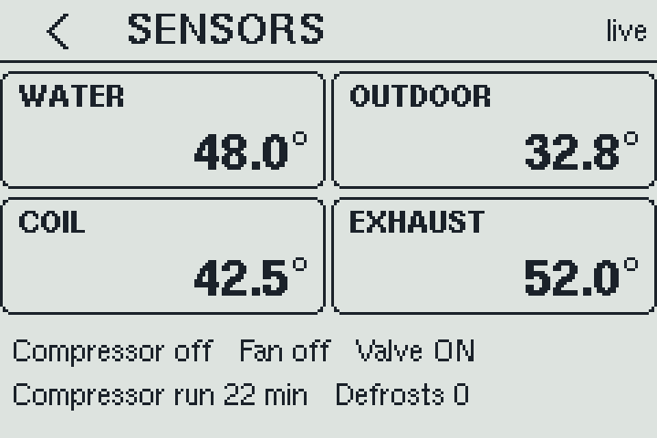<br>
<sub><b>Sensors.</b> All four temperatures (water includes the U02 offset), relay states, compressor run time and defrost count.</sub>
</td>
<td align="center" width="50%">
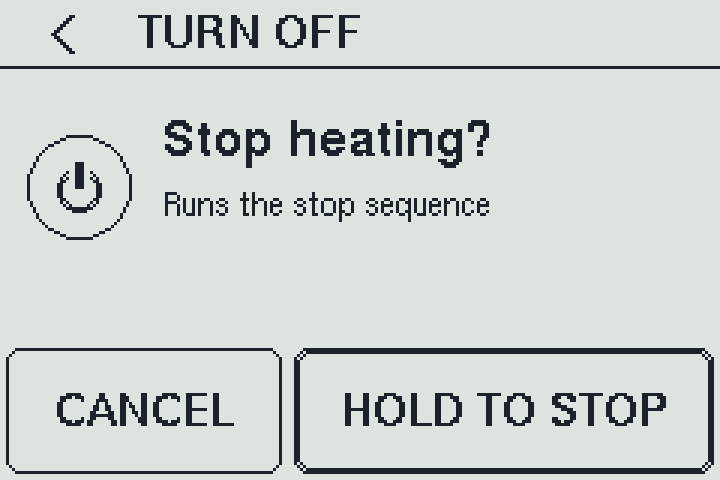<br>
<sub><b>Confirmations.</b> Actions that are hard to undo (stop heating, factory reset, forget WiFi) need a press-and-hold: the button fills up while held.</sub>
</td>
</tr>
<tr>
<td align="center" width="50%">
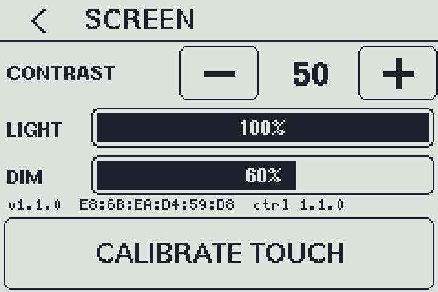<br>
<sub><b>Screen settings.</b> Contrast, backlight level and dim level (previewed live while dragging), firmware versions of both boards, and touch calibration.</sub>
</td>
<td align="center" width="50%">
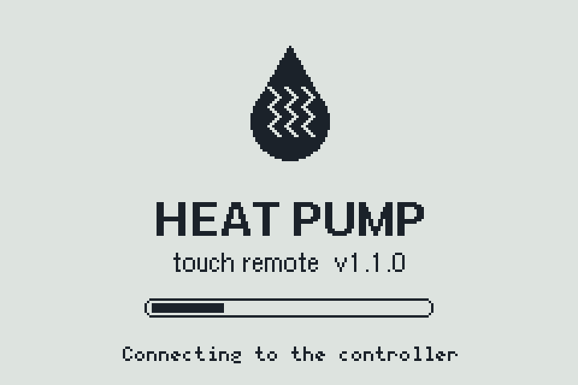<br>
<sub><b>Boot screen.</b> Shown while WiFi connects. Screens change with a short slide, sized for the slow FSTN response.</sub>
</td>
</tr>
</table>

---

## Features

### Controller
- Full heat pump control logic (startup/shutdown sequences, auto defrost, anti-freeze, exhaust protection)
- Reads 4× NTC 10K/3470 temperature sensors
- Drives 4× relays (compressor, fan, 4-way valve, water pump)
- Sends full status to Remote every **500 ms** via ESP-NOW
- Receives and applies settings/commands from Remote instantly
- Works fully **standalone** — no Remote connection required

### Remote (both versions)
- **WiFi** via WiFiManager (setup portal on demand)
- **Home Assistant** integration via MQTT Discovery
- **Web page** at `http://heatpump.local`: live status, power, forced defrost, all settings, and firmware upload for both boards
- **Firmware updates without a cable**: the Remote updates itself from the web page, and sends the Controller's new image to it over ESP-NOW
- **All 12 parameters** configurable on the device (U01–U80)
- **SAVE mode** with up to 3 scheduled heating periods
- **Persistent settings** in NVS — survive power loss, synced to the Controller on boot and every 30 s
- **NTP time sync** when WiFi is connected
- **Buzzer**: click on input, melodies for faults and lost link
- **Comm LED**: lights when the Controller's status packets stop

### Button Remote (`env:remote`)
- **128×64 ST7567 LCD** with a text menu
- **5-button navigation** (up, down, enter, back, power)
- **Backlight PWM** with auto-dim after inactivity

### Touch Remote (`env:remote_s3`)
- **240×160 FSTN** panel, black on white with white LED backlight
- **Resistive touch** with 3-point calibration saved in NVS
- **Animated UI**: slide transitions, rolling values, spinning fan, moving heat waves, sliding toasts, blinking alarm banner
- **Press-and-hold** confirmation for stop heating, factory reset and forget WiFi
- **Alarm banner** for sensor faults and exhaust protection (tap to dismiss)
- **Adjustable** contrast, backlight and dim level; dims after 20 s, returns to the main screen after 30 s
- **Drop-in replacement** for the Button Remote: copies its settings and MAC address, so the Controller needs no change (see [Moving from the Button Remote](#moving-from-the-button-remote-to-the-touch-remote))

---

## ESP-NOW Communication

### Packet Types

| Packet | Direction | Interval | Description |
|--------|-----------|----------|-------------|
| `StatusPacket` | Controller → Remote | Every 500ms | Full state: relays, sensors, state machine |
| `CommandPacket` | Remote → Controller | On user action | SET_ONLINE or FORCE_DEFROST |
| `SettingsPacket` | Remote → Controller | On save + every 30s | Full settings sync |
| `InfoPacket` | Controller → Remote | About every 5 s | Controller firmware version and build date |
| `OTA_BEGIN / OTA_DATA / OTA_END / OTA_ABORT` | Remote → Controller | During an update | Controller firmware transfer |
| `OTA_ACK` | Controller → Remote | Reply to each OTA packet | Progress and errors |

### MAC Addresses (defined in `src/shared.h`)

```cpp
#define CTRL_MAC_BYTES   { 0x00, 0x70, 0x07, 0x25, 0x08, 0x74 }
#define REMOTE_MAC_BYTES { 0xE8, 0x6B, 0xEA, 0xD4, 0x59, 0xD8 }
```

The Controller **only accepts packets from `REMOTE_MAC_BYTES`**. Change both values to your own boards' MACs (each board prints its MAC on the serial port).

### WiFi channel

The Remote's channel follows the router it connects to. The Controller has no WiFi connection, so it **scans channels 1–13** until it hears the Remote, then stays on that channel. No channel setting is needed.

---

## Hardware

### Controller (Outdoor)

| Component | Details |
|-----------|---------|
| MCU | ESP32 DOIT DevKit V1 |
| Sensors | 4× NTC 10K/3470 |
| Relays | 4× relay module (Active LOW) |

#### NTC Sensors — wiring: `3.3V → 10KΩ → GPIO → NTC → GND`

| Sensor | GPIO |
|--------|------|
| Water tank | GPIO 36 |
| Pipe coil | GPIO 39 |
| Compressor exhaust | GPIO 34 |
| Outdoor ambient | GPIO 35 |

> GPIO 34, 35, 36, 39 are **input-only** — external 10KΩ pull-up to 3.3V required.

#### Relays (Active LOW)

| Relay | GPIO | Load |
|-------|------|------|
| Compressor | GPIO 26 | 30A |
| Outdoor Fan | GPIO 27 | 3A |
| 4-way Valve | GPIO 14 | 3A |
| Water Pump | GPIO 33 | 3A |

---

### Button Remote (Indoor, `env:remote`)

| Component | Details |
|-----------|---------|
| MCU | ESP32 DOIT DevKit V1 |
| Display | ST7567 128×64 LCD |
| Buttons | 5× momentary push button |

#### LCD (ST7567) — Hardware SPI

| LCD Pin | GPIO | Note |
|---------|------|------|
| CS | GPIO 0 | Chip Select |
| RST | GPIO 16 | Reset |
| DC | GPIO 2 | Data/Command |
| SCK | GPIO 18 | SPI Clock (VSPI) |
| SDI | GPIO 23 | SPI Data (VSPI) |
| LED | GPIO 15 | Backlight PWM, **active LOW** |
| VCC | 3.3V | |
| GND | GND | |

#### Buttons (INPUT_PULLUP)

| Button | GPIO |
|--------|------|
| POWER (long press = on/off) | GPIO 27 |
| UP | GPIO 32 |
| DOWN | GPIO 33 |
| ENTER | GPIO 25 |
| BACK | GPIO 26 |

Buzzer on GPIO 14, comm LED on GPIO 17.

---

### Touch Remote (Indoor, `env:remote_s3`)

| Component | Details |
|-----------|---------|
| MCU | ESP32-S3-WROOM-1 **N16R2** (16 MB QIO flash, 2 MB quad PSRAM), bare module, native USB |
| Display | EastRising **ERC240160FS-2**: 3.4" 240×160 FSTN, ST7586S, 4-wire SPI, 25-pin 0.5 mm FPC (bottom contact) |
| Touch | 4-wire resistive, on the display |
| Backlight | White LED, max 125 mA, switched by an AO3400 N-MOSFET |
| Buzzer | Passive buzzer, switched by an AO3400 |
| Partition table | [`partitions_s3_16MB.csv`](partitions_s3_16MB.csv): NVS at 0x9000 (same as the ESP32 boards), two 6 MB OTA slots |

All S3 pins are in [`src/pins_s3.h`](src/pins_s3.h). Strapping pins (0, 3, 45, 46), USB (19, 20) and flash/PSRAM pins (26–37) are left free.

#### Display FPC wiring

| FPC pin | Name | Connect to |
|---|---|---|
| 1 | ESD | NC |
| 2 | VG | **1 µF** ceramic → GND |
| 3 | XV0 | **1 µF / 25 V** ceramic **between pin 3 and pin 4** |
| 4 | V0 | (same capacitor as pin 3) |
| 5 | VM | **1 µF** ceramic → GND |
| 6 | VDD | 3.3 V, plus 0.1 µF + 10 µF → GND near the connector |
| 7 | VSS | GND |
| 8 | VD1 | **1 µF → GND only. Never connect to 3.3 V** (it is the chip's internal 1.8 V regulator output) |
| 9 | CSB | GPIO 10 |
| 10 | IF3 | GND |
| 11 | IF2 | 3.3 V |
| 12 | IF1 | 3.3 V (IF3/IF2/IF1 = L/H/H selects 4-wire SPI) |
| 13 | RST | GPIO 14 |
| 14 | E_RD | 3.3 V |
| 15–20 | D7–D2 | GND |
| 21 | D1 | GPIO 9 (A0 = data/command) |
| 22 | D0 | GPIO 11 (SDA, MOSI) |
| 23 | RW_WR | 3.3 V |
| 24 | A0 | **GPIO 12 (SCL, clock)** |
| 25 | ESD | NC |

> [!WARNING]
> Pin 24 named "A0" is the **clock** and pin 21 "D1" is the **data/command** line.
>
> The capacitor layout follows Fig. 10 of the ST7586S datasheet: one capacitor across V0–XV0, and VG and VM to GND. With a capacitor from each of V0 and XV0 to GND, and VD1 tied to 3.3 V, the panel only showed smeared vertical stripes. Use ceramic capacitors with a known rating: XV0 is negative (about −7 V), V0 about +9 V.
>
> Do not plug or unplug the FPC with power on.

Measured on a working unit at the default contrast: VG 2.3 V, VM 1.16 V, V0 9 V, XV0 −6.7 V (V0 − XV0 ≈ 15.7 V), VD1 1.8 V.

#### Touch

| Touch | GPIO |
|---|---|
| Layer A, either pin | GPIO 4 (ADC1) |
| Layer A, other pin | GPIO 6 |
| Layer B, either pin | GPIO 5 (ADC1) |
| Layer B, other pin | GPIO 7 |

Find the layers with an ohmmeter before wiring: the two pins of one layer read a few hundred ohms, pins of different layers read open (until the screen is pressed). GPIO 4 and 6 must be on one layer, GPIO 5 and 7 on the other. Which pin goes where within a layer does not matter: the calibration finds swapped and mirrored axes by itself.

#### Backlight, buzzer, LED

```
Backlight                                   Buzzer
5V ─[33Ω ¼W]─► A (red)                      5V ─┬─► buzzer + ─┐
              K (black) ─► Drain              │              │
                          AO3400            1N4148      buzzer − ─► Drain
                          Source ─► GND     (band at 5V)            AO3400
GPIO15 ─[100Ω]─► Gate                         └──────────────┘      Source ─► GND
                 Gate ─[100kΩ]─► GND        GPIO16 ─[100Ω]─► Gate, Gate ─[100kΩ]─► GND

Comm LED:  GPIO17 ─[330Ω]─► LED anode, cathode ─► GND
```

- The backlight runs from 5 V so the resistor sets the current (about 60 mA); from 3.3 V it would vary a lot between units. Stay below 125 mA (resistor ≥ 22 Ω).
- The diode across a magnetic buzzer absorbs the coil's turn-off spike. A piezo buzzer does not need it.
- The 100 kΩ gate resistors keep the loads off while the S3 boots.

---

## Software

### Project Structure

```
src/
├── shared.h              ESP-NOW packet structs + MAC addresses (shared)
├── config.h              Pin definitions & constants
├── settings.h/cpp        NVS persistent storage + dirty flag
├── fw_info.h/cpp         Version + role stamp in every image (checked before flashing)
│
├── main_ctrl.cpp         Controller entry point
├── espnow_ctrl.h/cpp     Controller ESP-NOW (status out, cmd/settings in, channel scan)
├── control.h/cpp         Heat pump state machine
├── sensors.h/cpp         NTC temperature reading
├── relays.h/cpp          Relay output control
├── ota_ctrl.h/cpp        Receives its own firmware over ESP-NOW
│
├── espnow_remote.h/cpp   Remote ESP-NOW (status in, cmd/settings out)
├── control_remote.cpp    Proxy control.h — returns cached ESP-NOW data
├── sensors_remote.cpp    Proxy sensors.h — returns cached ESP-NOW data
├── wifi_mqtt.h/cpp       WiFi + MQTT + HA Discovery
├── web.h/cpp, web_page.h Web page, JSON API, firmware upload
├── ota_remote.h/cpp      Stages the Controller image and sends it over ESP-NOW
├── buzzer.h/cpp          Non-blocking melodies on the buzzer
│
├── main_remote.cpp       Button Remote entry point
├── display.h/cpp         ST7567 LCD (U8g2)
├── buttons.h/cpp         Debounced button input
├── menu.h/cpp            Text menu system
│
├── main_remote_s3.cpp    Touch Remote entry point (MAC takeover, see below)
├── pins_s3.h             Touch Remote pin map
├── lcd_s3.h/cpp          ERC240160 init (datasheet power-on flow), backlight, frame send
├── touch_s3.h/cpp        Resistive touch reading + calibration storage
├── ui_s3.h/cpp           Touch UI: screens, widgets, icons, animations
│
├── bringup_s3.cpp        Hardware bring-up firmware for a new S3 board
└── diag_s3.cpp           ST7586S diagnostics (register read-back, Vop/bias over Serial)
```

### Build Environments (PlatformIO)

| Environment | Board | Purpose |
|---|---|---|
| `controller` | ESP32 | Outdoor Controller |
| `remote` | ESP32 | Button Remote |
| `remote_s3` | ESP32-S3 | **Touch Remote** |
| `s3_bringup` | ESP32-S3 | Tests a new board: image, contrast, backlight, touch calibration, buzzer, LED |
| `s3_diag` | ESP32-S3 | Display diagnostics driven over Serial |

```bash
pio run -e controller --target upload    # outdoor ESP32
pio run -e remote     --target upload    # Button Remote
pio run -e remote_s3  --target upload    # Touch Remote (native USB, no buttons needed)
```

After the first USB flash, both Remotes and the Controller can be updated from the web page.

### Dependencies (Remote only)

```ini
lib_deps =
    olikraus/U8g2@^2.35.19
    knolleary/PubSubClient@^2.8
    bblanchon/ArduinoJson@^6.21.5
    tzapu/WiFiManager@^2.0.17
```

---

## First Boot

### Remote
1. Open WiFi setup from the menu (Button Remote: **WiFi Setup → Start WiFi Setup**; Touch Remote: **WIFI → SETUP**). The Remote creates the WiFi AP **`HeatPump-Setup`** for 5 minutes.
2. Connect with a phone or laptop → the setup page opens (or browse to `192.168.4.1`)
3. Enter WiFi credentials + MQTT broker details (host, port, user, pass)
4. The Remote connects, gets NTP time, and starts sending settings to the Controller via ESP-NOW

### Controller
1. Power on → scans the WiFi channels until it hears the Remote
2. Uses last saved settings from NVS until the Remote syncs
3. Starts the control loop immediately — no WiFi needed

### Touch Remote: touch calibration
A calibration is saved in NVS. To redo it: **SCREEN → CALIBRATE TOUCH**, or hold a finger on the screen while powering on. Touch the three targets with a stylus or fingernail.

---

## Web Page and Firmware Updates

Both Remotes serve a page at **`http://heatpump.local`** (or the Remote's IP address).

- **Login:** user `admin`, default password `heatpump`. **Change the password on the page**: anyone on the home network can otherwise control the heating.
- Live status, power on/off, forced defrost, and every setting (setpoint, parameters, SAVE periods, MQTT, web password)
- **Update Remote:** upload `.pio/build/<env>/firmware.bin` of the Remote's own environment
- **Update Controller:** upload `.pio/build/controller/firmware.bin`. The Remote stores the image, sends it to the Controller over ESP-NOW, and the Controller verifies it before rebooting into it. The Controller switches all relays off during the transfer.

Every image carries a role stamp (`fw_info`), and the ESP-IDF checks the chip type, so a Controller image cannot be flashed into a Remote or the other way round, and an ESP32 image cannot be flashed into the S3.

---

## Moving from the Button Remote to the Touch Remote

The Touch Remote replaces the Button Remote without changing the Controller. It takes over two things from it:

1. **Its settings (NVS).** The Remote is the settings master: it sends its settings to the Controller at boot and every 30 s. A blank Remote holds defaults with the system **off**, so it would switch the heating off.
2. **Its MAC address.** The Controller only accepts packets from `REMOTE_MAC_BYTES`.

**Safety built into `env:remote_s3`:**
- It uses the old Remote's MAC **only if its NVS holds saved settings** (the `init` key). A blank board keeps its own MAC, shows **NOT PAIRED**, and the Controller ignores it. You can try every screen while the old Remote keeps running.
- It **never sends settings** while its NVS is blank.

**Steps** (both NVS partitions are at `0x9000`, size `0x5000`):

```bash
# 1. Read the Button Remote's settings (it is not changed). If the USB-serial
#    adapter has no auto-reset, hold GPIO0 low and reset the board first.
esptool.py --port <old-remote-port> --before no_reset read_flash 0x9000 0x5000 old_remote_nvs.bin

# 2. Power the Button Remote off and keep it off.

# 3. Write the settings into the Touch Remote. It reboots, takes the MAC over and connects.
esptool.py --chip esp32s3 --port <touch-remote-port> write_flash 0x9000 old_remote_nvs.bin
```

The copy also brings over the WiFi credentials, MQTT settings and web password. It replaces the Touch Remote's own NVS, so its contrast and touch calibration fall back to the built-in defaults (re-calibrate from **SCREEN** if needed). Keep `old_remote_nvs.bin` as a backup.

> [!IMPORTANT]
> Never power both Remotes at the same time after step 3: they share one MAC address. To go back, power the Touch Remote off and the Button Remote on.

Once the Touch Remote has proven itself, the Controller can be switched to its own MAC: set `REMOTE_MAC_BYTES` in `src/shared.h` to the S3's factory MAC, flash the Controller, and remove the MAC takeover.

---

## Screenshots from the Device

`env:remote_s3` answers two commands on its USB serial port (115200 baud):

| Command | Action |
|---|---|
| `go <screen>` | Opens `main`, `menu`, `params`, `edit`, `periods`, `period`, `sensors`, `screen`, `confirm` or `boot` |
| `shot` | Prints the current frame: `SHOT 240 160`, then 160 lines of 60 hex digits (1 bit per pixel, MSB = left), then `END` |

The screenshots in this README were made this way and scaled 3× with Python/Pillow.

---

## Troubleshooting the Touch Remote

| Symptom | Cause |
|---|---|
| Vertical stripes or smeared image, contrast barely changes | Capacitor wiring or VD1. Use one capacitor across V0–XV0 and VG/VM to GND, and never tie VD1 to 3.3 V (see [Display FPC wiring](#display-fpc-wiring)) |
| Image correct but faint or dark | **SCREEN → CONTRAST** (50 suits the tested panel; the value sets Vop = 0x100 + contrast) |
| Touch readings bunched near the top of the ADC range and following both axes | Touch pins from different layers are paired. Swap GPIO 5 and GPIO 6 |
| Touch mirrored or off target | Re-calibrate: **SCREEN → CALIBRATE TOUCH** |
| Shows NOT PAIRED | Its NVS has no saved settings yet: copy them from the Button Remote |
| Shows NO LINK | No status from the Controller for 1.5 s: check that the Controller is powered and that only one Remote is on |

---

## Home Assistant

Auto-discovers via MQTT. All entities appear automatically after connecting to the broker.

| Entity | Type | Description |
|--------|------|-------------|
| Heat Pump | `climate` | On/off + setpoint + current temp |
| HP Water Temp | `sensor` | Water tank temperature |
| HP Pipe Temp | `sensor` | Pipe coil temperature |
| HP Exhaust Temp | `sensor` | Compressor exhaust temperature |
| HP Outdoor Temp | `sensor` | Outdoor temperature |
| HP Compressor | `binary_sensor` | Compressor running state |
| HP Defrost | `binary_sensor` | Defrost cycle active |

### MQTT Topics

| Topic | Direction | Description |
|-------|-----------|-------------|
| `heatpump/state` | Remote → HA | Full JSON state |
| `heatpump/cmd` | HA → Remote | Commands |
| `heatpump/available` | Remote → HA | `online` / `offline` (LWT) |

**Command examples:**
```json
{"mode": "heat"}
{"mode": "off"}
{"setpoint": 45.0}
{"work_mode": "save"}
{"force_defrost": true}
```

---

## Control Logic

Runs on the **Controller** board.

### Startup Sequence
```
PUMP ON → 30s → FAN ON + VALVE → 30s → COMPRESSOR ON
```

### Shutdown Sequence
```
COMPRESSOR OFF → 30s → FAN OFF + VALVE → 30s → PUMP OFF
```

### Auto Defrost
- Triggers after compressor runs ≥ **U30** min AND pipe temp ≤ **U31°C**
- Sequence: COMP+FAN off → 55s → valve reverses → 5s → COMP on
- Ends when pipe temp ≥ **U32°C** or max **U33** min reached

### Protections
- **Compressor delay:** 3-minute minimum off time before restart
- **Exhaust protection:** stops heating if exhaust > U51+10°C (U50)
- **Anti-freeze:** pump runs 3 min every 30 min when outdoor < 2°C (U52)

---

## Parameters Reference

| Code | Function | Range | Default |
|------|----------|-------|---------|
| U03 | Maximum setpoint | 30–70°C | 55°C |
| U01 | Hysteresis | 2–10°C | 5°C |
| U02 | Water sensor calibration | ±9.9°C | 0.0°C |
| U30 | Defrost start time | 10–90 min | 45 min |
| U31 | Defrost start temperature | -20–0°C | -5°C |
| U32 | Defrost stop temperature | 2–30°C | 10°C |
| U33 | Max defrost time | 2–15 min | 8 min |
| U34 | Valve mode (0=heat-off, 1=heat-on) | 0/1 | 0 |
| U50 | Exhaust protection mode | 0–2 | 1 |
| U51 | Exhaust protection temp | 50–125°C | 110°C |
| U52 | Anti-freeze | 0/1 | 1 |
| U80 | Auto restart after power loss | 0/1 | 0 |

The setpoint itself ranges from 10°C to U03.

---

## License

[Apache License 2.0](LICENSE)
